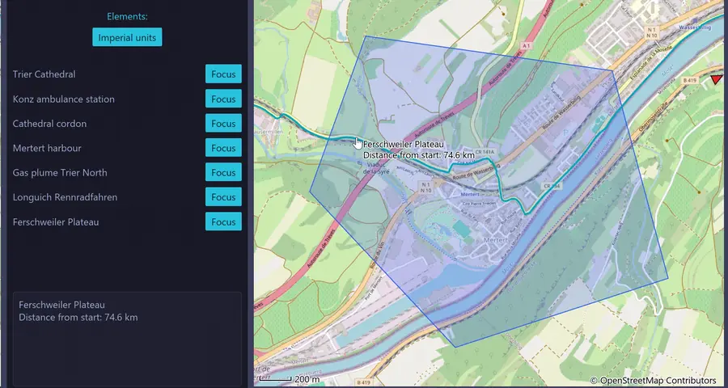

# map_iced

[](https://github.com/Carbonfreezer/map_iced/actions/workflows/ci.yml)

A map widget for the [iced](https://iced.rs) GUI framework in Rust, with way points,
regions and paths as interactive annotations.



## Features

- **Tile maps** from any provider that follows the
  [slippy map convention](https://wiki.openstreetmap.org/wiki/Slippy_map_tilenames):
  OpenStreetMap, Mapbox (tilesets and satellite), Thunderforest, MapTiles API or a
  URL pattern of your own.
- **A tile cache on disk** with a size limit, shared by all map widgets of the
  application, that can be cleared at runtime to reload outdated tiles or to remove
  it for good.
- **Way points** with image or cross markers, hover texts and flags whose direction
  arrows point to them when they are off screen.
- **Regions**: circles, sectors and convex hulls, e.g. for a cordon or a forecast gas
  plume, replaceable without losing their key or style.
- **Paths**, e.g. GPX tracks, with the distance from the start at the hovered point.
- **Events as iced messages**: selection, hover, clicks on the map or on a direction
  arrow, and the arrival of a focus animation.
- **Focus**: a hard jump or a soft animation to an annotation or a position.
- A scale bar in metric or imperial units.

## Why choose map_iced?

map_iced is a native iced widget, not a general map renderer. It shows raster tiles
(OSM, Mapbox, Thunderforest, …) and gives you way points, regions and paths as Rust
objects whose hover, selection and focus come back as iced messages. It builds with
plain `cargo`, no C++ toolchain. If you need vector tiles, runtime map styling,
rotation or 3D, use [MapLibre](https://maplibre.org); if you want a map inside an
iced application with interactive annotations and minimal integration effort, use
map_iced.

## Getting started

map_iced is not on crates.io yet. Add it from GitHub:

```toml
[dependencies]
map_iced = { git = "https://github.com/Carbonfreezer/map_iced" }
iced = "0.14"
```

A minimal application with one map:

```rust
use iced::{Element, Task};
use map_iced::gui_system::map_widget_system::{MapEvent, MapWidgetMessage, MapWidgetSystem};
use map_iced::gui_system::tile_cache_construction::TileCacheConfig;

struct Application {
    map: MapWidgetSystem,
    widget_id: u32,
}

#[derive(Debug, Clone)]
enum Message {
    Map(MapWidgetMessage),
}

impl Application {
    fn boot() -> (Self, Task<Message>) {
        // Your own application name and e-mail instead of the placeholder.
        let config = TileCacheConfig::open_street_map("PlaceholderMapping");
        let (mut map, task) = MapWidgetSystem::boot(config).expect("tile cache set up");
        let widget_id = map.request_new_widget();
        (Self { map, widget_id }, task.map(Message::Map))
    }

    fn update(&mut self, message: Message) {
        let Message::Map(message) = message;
        if let Some(MapEvent::Error(text)) = self.map.process_message(message) {
            eprintln!("{text}");
        }
    }

    fn view(&self) -> Element<'_, Message> {
        self.map
            .canvas(self.widget_id)
            .map(|command| Message::Map(command.into()))
    }
}

fn main() -> iced::Result {
    iced::application(Application::boot, Application::update, Application::view).run()
}
```

The tile source can also come from a JSON file, which keeps API keys out of the
source code. The module documentation of `tile_cache_construction` describes the
format.

## Running the examples

```sh
cargo run --example basic_gui_test      # two maps side by side
cargo run --example waypoint_gui_test   # way points, selection, hard and soft focus
cargo run --example region_gui_test     # regions, GPX tracks and focus (the video above)
```

The examples read their tile configuration from `examples/assets/osm.json`, which
is compiled in.

> **Put in your own user agent before you run them.** Replace `PlaceholderMapping`
> in `examples/assets/osm.json` with your application name and your e-mail, e.g.
> `"MyMapApp/1.0 (me@mydomain.org)"`. The
> [OpenStreetMap tile usage policy](https://operations.osmfoundation.org/policies/tiles/)
> asks for a user agent that identifies the application, and OSM blocks user agents
> that are shared by many installations. A blocked request returns an "Access
> blocked" image instead of the tile, and the cache stores it like a normal tile. If
> you were blocked, fix the user agent and press "Clear cache" in `basic_gui_test`,
> or delete the cache folder (`cache/osm` for the examples).

## Working from the repository

Only relevant if you cloned the code from GitHub; the documentation of the
published crate is on [docs.rs](https://docs.rs/map_iced).

To build the documentation locally and open it in the browser:

```sh
cargo doc --no-deps --open
```

`--no-deps` leaves out the documentation of all dependencies, iced included, which
would otherwise make the build many times larger and slower.

To run the tests, e.g. before a pull request:

```sh
cargo test
```

One test that downloads a tile from OpenStreetMap is ignored by default, so the
test suite does not send requests to the OSM servers.

## License

MIT, see [LICENSE](LICENSE).
